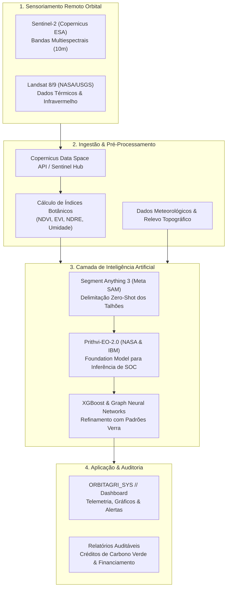

# OrbitAgri — Sistema Global de Monitoramento de Carbono Orgânico no Solo (SOC)

**Autor:** Renan Santa Rosa Xavier — RM566997 | 🌐 **Portfólio:** [renan-xavier.vercel.app](https://renan-xavier.vercel.app)  
**Instituição:** FIAP — Análise e Desenvolvimento de Sistemas

---

## 📌 Visão Geral do Projeto

O **OrbitAgri** é uma plataforma SaaS projetada para a **Global Solution FIAP**, voltada à democratização do mercado voluntário de créditos de carbono para produtores rurais.

O projeto substitui o **MRV analógico** (medição presencial, cara e invasiva com perfurações manuais de solo) por um ecossistema digital baseado em **sensoriamento remoto orbital** e **modelos fundacionais de Inteligência Artificial**. A solução cruza imagens multiespectrais diárias com dados meteorológicos para calcular remotamente o estoque de **Carbono Orgânico no Solo (SOC)** e a saúde dos talhões.

---

## 🎬 Demonstração do Sistema

### Vídeo Pitch Oficial (Global Solution)
Assista à apresentação executiva e conceitual do OrbitAgri no YouTube:

> 🔗 **Assistir no YouTube:** [OrbitAgri — Global Solution FIAP](https://www.youtube.com/watch?v=UaOoXXTM8tI)

### Protótipo do Painel Analítico
Dashboard com métricas agronômicas, evolução do SOC e alertas preditivos de IA:

---

## 🏛️ Arquitetura da Solução

O fluxo do sistema integra dados orbitais, modelos de visão computacional e inferência geoespacial:

---

## 🛠️ Tecnologias Utilizadas

| Tecnologia | Aplicação na Solução |
| :--- | :--- |
| **Sentinel-2 (ESA) & Landsat (NASA)** | Constelações orbitais para captura de imagens multiespectrais gratuitas e de alta frequência. |
| **Sentinel Hub API** | Endpoint de ingestão e normalização de dados do Copernicus Data Space Ecosystem. |
| **Meta SAM 3 (Segment Anything)** | Modelo de segmentação visual para identificar e isolar os perímetros de talhões agrícolas sem necessidade de retreino. |
| **Prithvi-EO-2.0 (IBM & NASA)** | Modelo fundacional geoespacial de 100M+ parâmetros treinado em 7 anos de observações terrestres para converter refletância em toneladas de carbono por hectare. |
| **XGBoost & GNNs** | Algoritmos de calibração que cruzam os índices botânicos com a elevação topográfica e o histórico de uso do solo. |
| **UI/UX Design** | Interface analítica desenvolvida para dashboards de telemetria agronômica e auditoria de crédito de carbono. |

---

## 📑 Galeria da Apresentação Executiva

| Slide 1: Abertura | Slide 2: O Problema MRV | Slide 3: A Solução Espacial | Slide 4: Protótipo |
| :---: | :---: | :---: | :---: |
|  |  |  |  |

| Slide 5: Inteligência Artificial | Slide 6: Insights & Métricas | Slide 7: Rumo ao Futuro | Slide 8: Referências |
| :---: | :---: | :---: | :---: |
|  |  |  |  |

---

## 📚 Referências Técnicas

1. [Copernicus Data Space Ecosystem (Sentinel Hub API)](https://dataspace.copernicus.eu/)
2. [NASA Landsat Science Program](https://landsat.gsfc.nasa.gov/)
3. [IBM & NASA Geospatial Foundation Models (Prithvi-EO)](https://huggingface.co/ibm-nasa-geospatial)
4. [Meta Research — Segment Anything Model (SAM)](https://segment-anything.com/)
5. [Verra — Verified Carbon Standard (VCS) Methodologies](https://verra.org/)
