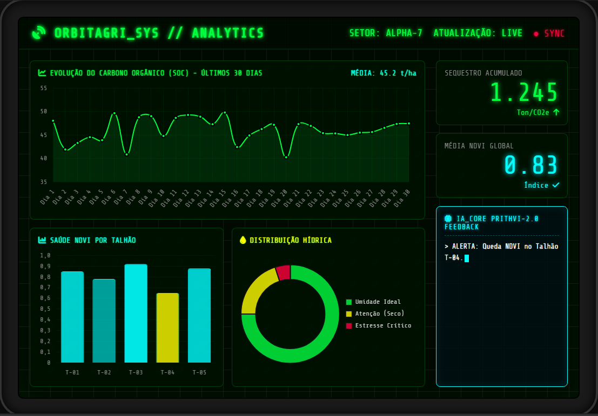
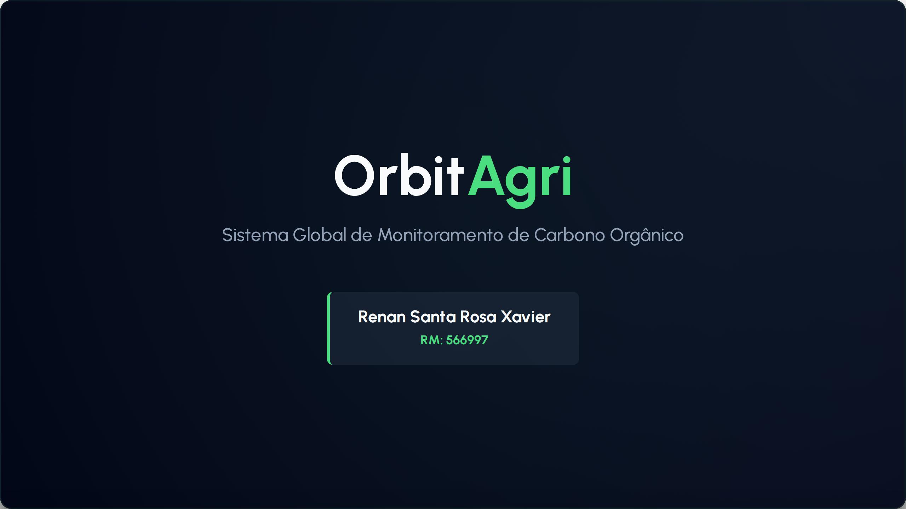
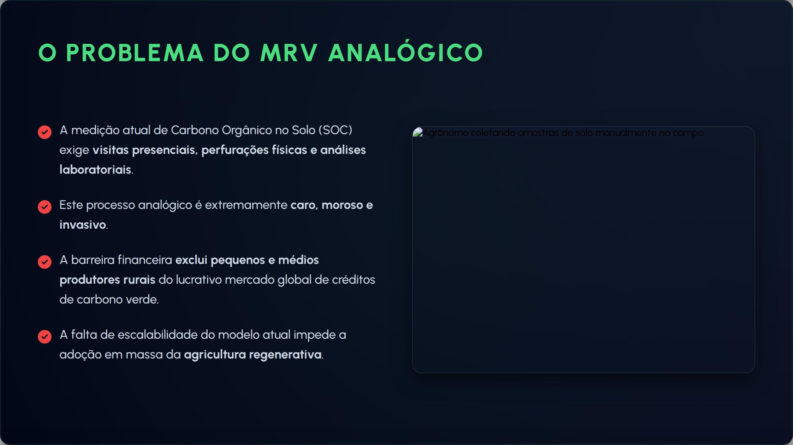
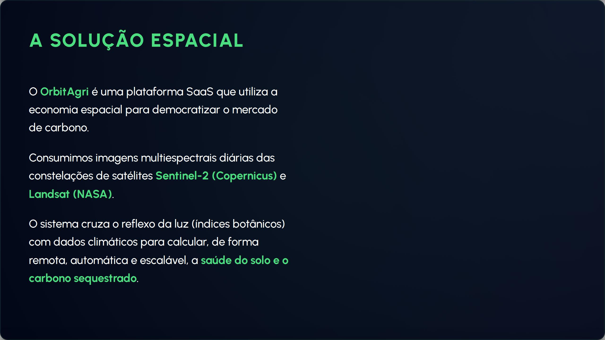
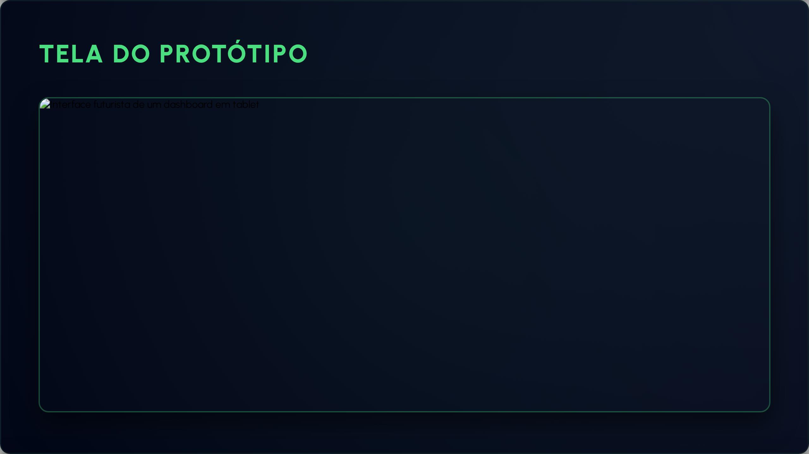
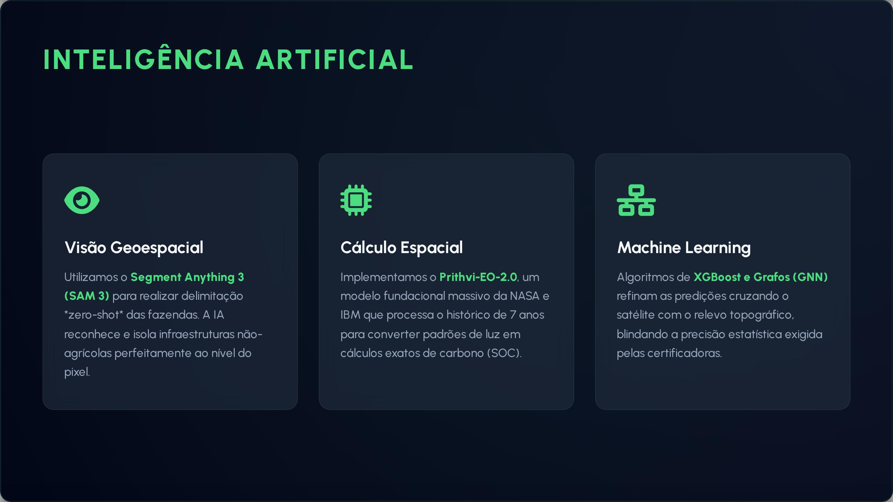
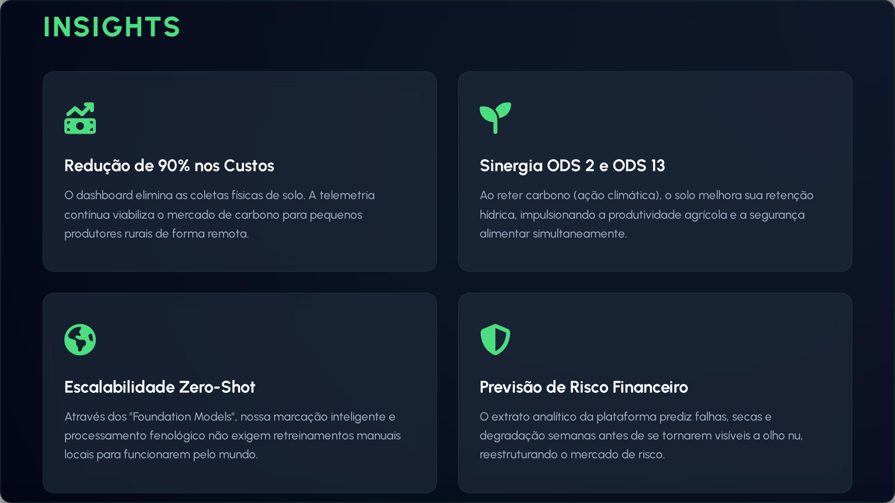
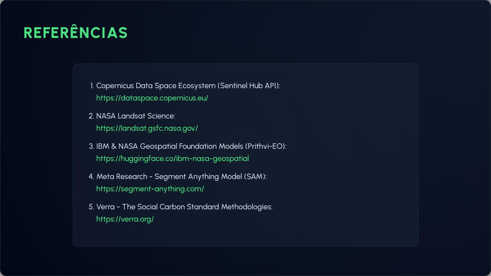

# OrbitAgri — Sistema Global de Monitoramento de Carbono Orgânico no Solo (SOC)

**Autor:** Renan Santa Rosa Xavier — RM566997 | 🌐 **Portfólio:** [renan-xavier.vercel.app](https://renan-xavier.vercel.app)  
**Instituição:** FIAP — Análise e Desenvolvimento de Sistemas

---

## 🎬 Vídeo de Apresentação (Pitch Global Solution)

Assista ao pitch completo do **OrbitAgri** gravado para a banca da Global Solution FIAP no YouTube:

> 🔗 **Assistir no YouTube:** [OrbitAgri — Global Solution FIAP](https://www.youtube.com/watch?v=UaOoXXTM8tI)

---

## 🛰️ Visão Geral da Solução

O **OrbitAgri** é uma plataforma SaaS que utiliza a economia espacial e modelos fundacionais de Inteligência Artificial para democratizar o mercado voluntário de créditos de carbono para pequenos e médios produtores agrícolas.

### 🔴 O Problema do MRV Analógico
* A medição tradicional de **Carbono Orgânico no Solo (SOC)** exige coletas físicas presenciais, perfurações de solo e análises laboratoriais demoradas.
* Processo extremamente custoso, moroso e invasivo, criando uma barreira financeira que exclui produtores rurais familiares do mercado global de créditos verdes.
* A falta de escalabilidade do modelo analógico impede a adoção em massa da agricultura regenerativa.

### 🟢 A Solução Espacial Digital
* Ingestão diária de dados multiespectrais das constelações de satélites **Sentinel-2** (Agência Espacial Europeia / Copernicus) e **Landsat** (NASA).
* Cruzamento de bandas espectrais (índices botânicos como NDVI, EVI e NDRE) com dados agrometeorológicos para estimativa contínua, não invasiva e escalável da saúde do solo e do estoque de carbono sequestrado.

---

## 🖥️ Painel Analítico da Plataforma (Protótipo)

Dashboard de telemetria em tempo real projetado para monitoramento agronômico e auditoria contínua de créditos de carbono:

### Principais Módulos do Dashboard:
1. **Curva de Evolução do SOC:** Histórico de 30 dias de carbono orgânico no solo por hectare.
2. **Saúde NDVI por Talhão:** Segmentação individual de áreas de plantio com índice de vigor vegetativo.
3. **Balanço Hídrico & Estresse:** Detecção precoce de anomalias hídricas e risco de dessecação.
4. **Alerta Proativo de IA:** Feedback em tempo real via **IA Core Prithvi-2.0** alertando variações críticas em talhões específicos.

---

## 🧠 Arquitetura de Inteligência Artificial

| Pilar | Tecnologia | Aplicação no OrbitAgri |
| :--- | :--- | :--- |
| **Visão Geoespacial** | Segment Anything Model 3 (SAM 3) | Delimitação automatizada (*zero-shot*) dos talhões e isolamento de estradas e sedes ao nível do pixel. |
| **Cálculo Espacial** | Prithvi-EO-2.0 (NASA & IBM) | Modelo fundacional geoespacial treinado em 7 anos de dados multiespectrais para inferência de SOC. |
| **Machine Learning** | XGBoost & Graph Neural Networks (GNN) | Fusão de dados topográficos, elevação de terreno e telemetria para calibração com validação padrão Verra. |

---

## 📈 Impactos e Diferenciais Estratégicos

* **Redução de 90% nos custos de certificação:** Eliminação da dependência de amostragem presencial de solo constante.
* **Escalabilidade Zero-Shot:** Aplicação imediata em qualquer região produtiva do Brasil sem necessidade de calibração manual prévia.
* **Alinhamento ESG & ODS:** Contribuição direta para o **ODS 2** (Agricultura Sustentável) e **ODS 13** (Ação Climática).
* **Mitigação de Risco Financeiro:** Relatórios analíticos auditáveis para bancos concederem crédito rural verde com taxas bonificadas.

---

## 📑 Galeria da Apresentação Executiva

| Slide 1: Abertura | Slide 2: O Problema MRV | Slide 3: A Solução Espacial | Slide 4: Protótipo |
| :---: | :---: | :---: | :---: |
|  |  |  |  |

| Slide 5: Inteligência Artificial | Slide 6: Insights & Métricas | Slide 7: Rumo ao Futuro | Slide 8: Referências |
| :---: | :---: | :---: | :---: |
|  |  |  |  |

---

## 📚 Referências Científicas e Técnicas

1. [Copernicus Data Space Ecosystem (Sentinel Hub API)](https://dataspace.copernicus.eu/)
2. [NASA Landsat Science Program](https://landsat.gsfc.nasa.gov/)
3. [IBM & NASA Geospatial Foundation Models (Prithvi-EO)](https://huggingface.co/ibm-nasa-geospatial)
4. [Meta Research — Segment Anything Model (SAM)](https://segment-anything.com/)
5. [Verra — Verified Carbon Standard (VCS) Methodologies](https://verra.org/)
